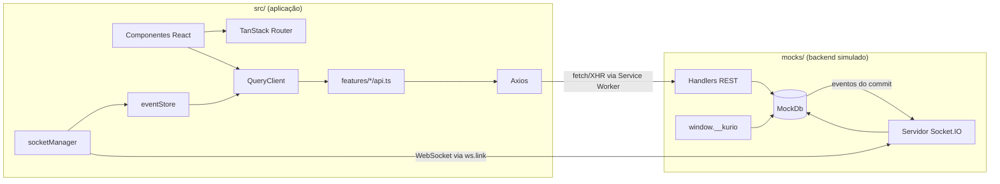
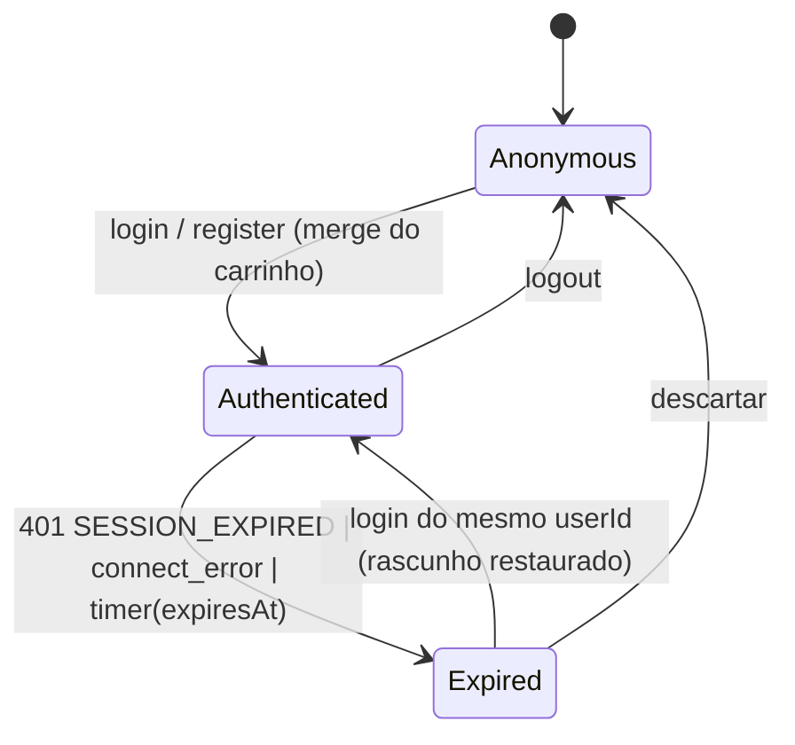
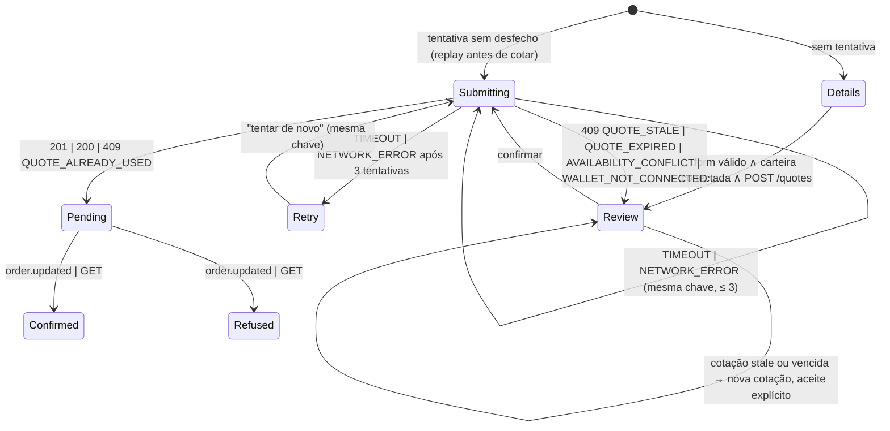

# Arquitetura · Kurio

Desenho alvo (2026-10-19), anterior ao código e revisado contra ele na entrega. Este documento dá as
regras; quando o código existir, o detalhe de implementação mora nele e aqui fica o link. Contratos
de transporte em [API](API.md); justificativas em [DECISIONS](DECISIONS.md).

## 1. Contexto e restrições

- SPA estática servida por CDN. Não existe processo de servidor em nenhum ambiente.
- O backend é o MSW **no mesmo contexto JavaScript da página**: o Service Worker só encaminha o
  `fetch` à thread principal, onde os handlers rodam, e `ws.link` intercepta o `WebSocket` também ali.
  Handlers REST e servidor Socket.IO simulado compartilham memória.
- Requisitos que moldam o desenho: isolamento por usuário (eliminatório), idempotência de pedido,
  tolerância a eventos duplicados e fora de ordem, precisão decimal de 18 casas.

## 2. Componentes



## 3. Módulos e regra de dependência

| Módulo | Responsabilidade | Pode importar |
|---|---|---|
| `src/contracts` | Schemas Zod e tipos inferidos | `zod` |
| `src/lib/http` | Axios, interceptors, `normalizeError`, `configureHttp` | `contracts` |
| `src/lib/eth` | Aritmética de wei, `formatEth`, `parseEthInput` | nada |
| `src/lib/url` | `safeRedirect` | nada |
| `src/lib/query` | `queryClient`, `keys.ts`, política de retry, wrapper de `queryFn` que semeia versões | `contracts`, `lib/realtime/eventStore` (módulo puro: não há ciclo) |
| `src/lib/realtime` | `socketManager`, `eventStore`, `useNftSubscription`, ponte com o cache | `contracts`, `lib/query` |
| `src/lib/session` | `sessionStore`, `switchIdentity`, detecção de expiração | `http`, `realtime`, `query`, `contracts` |
| `src/features/<domínio>/api.ts` | Uma função por endpoint: Axios + `schema.parse` | `lib/http`, `contracts` |
| `src/features/<domínio>/queries.ts` | `queryOptions` e mutations, com `lib/query/keys` | `api.ts`, `lib/query` |
| `src/features/<domínio>/components` | UI | `queries.ts`, `components/ui`, `lib/eth`, `lib/realtime`, `lib/session`, `lib/url` |
| `src/routes` | Rotas, `beforeLoad`, `loader`, composição das telas | `features/*`, `lib/session`, `lib/url` |
| `mocks/` | Backend simulado | `src/contracts`, `src/lib/eth` (só isso) |

Duas dependências que parecem necessárias são invertidas, sem import:

- `lib/http` lê token, carrinho de visitante e aviso de expiração por funções que o bootstrap entrega
  em `configureHttp()`, porque `lib/session` já importa `lib/http`.
- `lib/realtime` recebe o usuário corrente em `eventStore.reset(userId)`, chamado pelo `switchIdentity`.

Imposição por lint:

- `no-restricted-imports`: `src/**` não importa `mocks/**` (exceção única: `src/main.tsx` importa
  `mocks/browser`, por `overrides` restrito ao arquivo); `components/**` não importa `api.ts`,
  `lib/http` nem `axios`; `lib/http` e `lib/realtime` não importam `lib/session`; `api.ts` não
  importa `react`.
- `no-restricted-globals`: `fetch` e `WebSocket` em `src/**`.
- `no-restricted-syntax`: `parseFloat` e `Number(` em `src/features/**`. `EthAmount` é string com
  brand: só `lib/eth` opera sobre ele.

## 4. Bootstrap

`main.tsx` sobe o MSW primeiro (exceto com `VITE_ENABLE_MOCKS=false`) e só então importa o app. A
ordem é obrigatória: o `socket.io-client` guarda o construtor `WebSocket` ao carregar, e carregado
antes do MSW ele usa o original e escapa da interceptação. Requisição `http(s)` sem handler é erro,
exceto os arquivos do próprio app (mesma origem, fora de `/api`); esquema que não é `http(s)`, como
o de extensões do navegador, é ignorado. O app chama `configureHttp` antes do primeiro render. `index.html` traz o casco estático (header e hero com dimensões finais), para que LCP
e CLS não dependam do bootstrap.

## 5. Transporte HTTP

Axios com `baseURL` de `VITE_API_BASE_URL` e timeout de 10 s.

| Ordem | Interceptor | Efeito |
|---|---|---|
| request 1 | `withRequestId` | `X-Request-Id: crypto.randomUUID()` |
| request 2 | `withAuth` | `Authorization: Bearer <token>` se houver token |
| request 3 | `withGuestCart` | `X-Guest-Cart-Id` se não houver token |
| response 1 | `normalizeError` | Toda falha vira `ApiError` |
| response 2 | `onSessionExpired` | `SESSION_EXPIRED` avisa a sessão, uma vez por token |

`ApiError` tem quatro tipos: `http` (corpo de erro da [API](API.md#erros) mais `status`), `network`
e `timeout` (ambos retryable) e `contract` (falha de `schema.parse`, com o `path`, nunca retryable).
Toda `queryFn` repassa `signal`: key que deixa de ser observada aborta a requisição.

## 6. Estado remoto

### 6.1 Keys

`lib/query/keys.ts` é a fonte única; nenhuma key é escrita à mão fora dele.

| Escopo | Keys |
|---|---|
| Público | `['catalog', 'list', normalize(q)]`, `['catalog', 'featured']`, `['nft', id]` |
| Identidade | `['session']`: só `{ userId, expiresAt }` |
| Privado | `['u', owner, ...]` com `cart`, `quote` (por rede e `cartVersion`), `order`, `favorites`, `me`, `wallets`; `owner` é o `userId` ou `guest:<id>` |

Invariante: **todo dado de pessoa vive sob `['u', owner]`**. A `queryFn` de `GET /auth/session` grava
`Session.user` em `me` e devolve só a identidade. `normalize` ordena listas e remove defaults, para
que URLs equivalentes compartilhem cache.

### 6.2 Política

| Query | `staleTime` | `gcTime` | Observação |
|---|---|---|---|
| `session` | 5 min | ∞ | `refetchOnWindowFocus`; só com token salvo |
| `catalog.list` | 30 s | 5 min | `keepPreviousData` |
| `catalog.featured`, `nft` | 60 s | 5 min | `nft` atualizado por evento |
| `cart`, `quote` | 0 | 1 min | sempre a resposta do servidor |
| `order` | 0 | 5 min | polling de 5 s só se `pending` e socket desconectado |
| `favorites`, `me`, `wallets` | 5 min | 5 min | |

Query repete só erro `retryable`, até 2 vezes, com backoff exponencial de 500 ms a 4 s e jitter.
Mutation não repete, exceto `createOrder` (§9.2).

### 6.3 Sincronização

| Gatilho | Operação no cache |
|---|---|
| Mutation de carrinho | grava `cart` com a resposta; invalida `quote` do dono |
| `POST /cart/merge` | grava `cart` do usuário; remove o escopo `guest:<id>` |
| Favorito | otimista (§6.4) |
| Perfil, avatar, carteira | grava `me` ou `wallets` com a resposta |
| `nft.updated` aceito | grava `nft`; nas listas que contêm o id, patch se a lista não depende de preço nem de disponibilidade, senão invalida (ordem e filtro mudariam); invalida `cart` e `quote` |
| `order.updated` terminal | grava `order`; invalida `cart` e `catalog` |
| Reconexão do socket | invalida as queries ativas lastreadas em tempo real |
| Troca de identidade | §8 |

### 6.4 Atualização otimista

Favoritos e quantidade no carrinho: cancela a key, guarda snapshot por mutation, aplica o patch;
no erro restaura o snapshot e anuncia; no fim invalida. Snapshot por mutation evita que mutations
concorrentes restaurem um estado já sobrescrito.

### 6.5 Estados de tela

Sem dado: skeleton com dimensões finais após 150 ms, ou bloco de erro com nova tentativa. Com dado e
refetch: mantém o conteúdo com indicador, nunca volta ao skeleton. Vazio é sucesso com ação própria.

## 7. Roteamento

| Rota | `beforeLoad` | `loader` |
|---|---|---|
| `__root` | `ensureQueryData(session)` sem lançar | |
| `/` | | prefetch de `featured` e da lista |
| `/nft/$nftId` | | `ensureQueryData(nft)`; `NOT_FOUND` vira `notFound()` |
| `/cart` | | prefetch de `cart` |
| `/checkout`, `/orders/$orderId`, `/account/*` | sem sessão: login com `redirect` | `ensureQueryData` da rota |
| `/login`, `/register` | com sessão: vai a `safeRedirect(redirect)` | |

Search params validados por Zod com `.catch` (inválido degrada ao default, nunca lança) e defaults
removidos da URL. `q` usa `replace` após debounce de 300 ms; filtro, ordenação e página usam `push`;
mudar qualquer coisa que não seja `page` volta a `page=1`. Preço vai à URL com ponto (§14).

## 8. Sessão



`switchIdentity(next)` é a única troca de identidade, nesta ordem:

1. cancela as queries
2. destrói o socket e chama `eventStore.reset(next?.user.id)`
3. remove `['u']` e `['session']` do cache
4. grava ou apaga `kurio:session`
5. cria o socket com o novo token
6. com `next`: grava `session` e `me`; se havia carrinho de visitante, `POST /cart/merge`

Entre os passos 3 e 6 nenhuma key guarda dado do usuário anterior.

**Expiração não é troca de identidade:** desconecta o socket e suspende as requisições privadas, mas
mantém cache, rascunho e tentativa de pedido. O mesmo `userId` retoma; outro usuário ou o descarte
passam pelo `switchIdentity`.

## 9. Carrinho, checkout e pedido

### 9.1 Máquina do checkout



`Confirmed` e `Refused` são terminais: ignoram eventos e param o polling. O recibo renderiza
**somente** com `status === 'confirmed'` lido do servidor. `Retry` não volta à edição: o pedido pode
já existir. Em `Review`, um timer pelo `expiresAt` pede nova cotação antes de confirmar uma vencida.

### 9.2 Idempotência

A tentativa (`kurio:checkout:attempt:<userId>`) guarda a `Idempotency-Key` (UUID), o `quoteId`, o
corpo e o hash do corpo, e existe só enquanto não há desfecho.

- **Uma tentativa sem desfecho nunca ganha chave nova.** Este é o invariante contra pedido duplicado.
- Botão `disabled` e `aria-busy` durante o envio; segundo clique é no-op.
- Timeout e rede reenviam o mesmo corpo com a mesma chave.
- Ao abrir `/checkout` com tentativa, reenvia **antes de qualquer `POST /quotes`**: 200 ou 201 vai ao
  pedido; rede ou timeout mantém a tentativa; 409 de cotação, estoque ou carteira apaga a tentativa e
  volta à revisão com cotação nova.
- `409 QUOTE_ALREADY_USED` traz o `orderId` existente: apaga a tentativa e vai ao pedido. É a defesa
  do servidor quando a tentativa local se perde.
- Formulário com tentativa sem desfecho fica somente leitura.

### 9.3 Rascunho

Formulário em `sessionStorage` (`kurio:checkout:draft:<userId>`), com debounce de 500 ms. Expiração
preserva `redirect=/checkout?step=...`; o rascunho só volta para o mesmo `userId`.

## 10. Tempo real

- Um socket por sessão, criado no `switchIdentity`, só transporte WebSocket, `autoConnect: false`,
  token em `auth`. `connect_error` com `SESSION_EXPIRED` expira a sessão e não reconecta.
- `connect_error` é terminal: depois dele o app não consulta `socket.connected`, que fica `true`
  porque o cliente se destrói antes de atualizar a flag. Com token inválido, `connect` dispara antes
  do `connect_error` (o binding aceita antes de ler o token), então o app só assina NFTs com sessão
  válida, nunca no `connect` puro.
- `useNftSubscription(ids)` conta referências por id: assina na transição 0 → 1, cancela na 1 → 0, e o
  cleanup remove os listeners que registrou.
- `eventStore.accept(evento)` descarta, nesta ordem: `id` já aplicado (LRU de 500), versão menor ou
  igual à maior conhecida do recurso, `audience` de outro usuário, pedido já terminal. As respostas
  REST semeiam a maior versão pelo wrapper de `queryFn`, então evento anterior a um GET aplicado é
  descartado. Só evento aceito vira anúncio na live region.
- Reconexão: reassina as subscriptions ativas e invalida `catalog`, `nft`, `cart`, `quote` e `order`
  pendente. O REST volta a ser a verdade e ressemeia as versões.

## 11. Erros na interface

| Origem | Tratamento |
|---|---|
| `VALIDATION_FAILED` | erro por campo; foco no primeiro inválido |
| `AVAILABILITY_CONFLICT`, `COUPON_*`, `*_TAKEN` | mensagem no componente de origem, estado do servidor restaurado |
| `QUOTE_STALE`, `QUOTE_EXPIRED` | nova cotação com diff, aceite obrigatório |
| `QUOTE_ALREADY_USED`, `IDEMPOTENCY_CONFLICT` | vai ao pedido de `details.orderId` |
| `SESSION_EXPIRED` | diálogo de expiração (§8) |
| `UNAUTHENTICATED` | login com `redirect` |
| `FORBIDDEN`, `NOT_FOUND` em recurso privado | mesma tela de "não encontrado", para não confirmar que o recurso alheio existe |
| `retryable` | retry automático em query; "tentar de novo" em mutation |
| `CONTRACT_VIOLATION` | `errorComponent` da rota; log com `path` em dev |
| Exceção não prevista | error boundary da raiz |

Falha de mutation é anunciada em live region `assertive`; sucesso em `polite`.

## 12. Persistência no cliente

| Chave | Storage | Conteúdo |
|---|---|---|
| `kurio:session` | local | `Session` |
| `kurio:guestCartId` | local | UUID |
| `kurio:checkout:attempt:<userId>` | local | tentativa de pedido |
| `kurio:checkout:draft:<userId>` | session | rascunho do formulário |
| `kurio:scenario` | local | cenário do mock |
| `kurio:mockdb:v<schema>` | local | snapshot do `MockDb` (só os mocks leem) |

Toda leitura é validada por Zod; inválida é tratada como ausente e nunca lança.

## 13. Segurança

- `safeRedirect` recusa `\`, caractere de controle e valor que não comece por exatamente uma `/`, e só
  aceita se `new URL(valor, location.origin)` mantiver a origem; recusado vira `/`. Regex sozinha não
  basta: `/\evil.com` passa em `^/(?!/)` e o navegador lê `//evil.com`.
- Sem `dangerouslySetInnerHTML`. Token nunca em URL nem em log; o identificador logado é o
  `X-Request-Id`.
- Senha só como hash PBKDF2-SHA256 (600 000 iterações, salt por usuário) no `MockDb`.
- Cabeçalhos no `vercel.json`:

  ```
  Content-Security-Policy: default-src 'self'; script-src 'self'; worker-src 'self'; connect-src 'self';
    img-src 'self' data: blob:; style-src 'self' 'unsafe-inline'; font-src 'self'; object-src 'none';
    base-uri 'self'; form-action 'self'; frame-ancestors 'none'
  X-Content-Type-Options: nosniff
  Referrer-Policy: strict-origin-when-cross-origin
  Permissions-Policy: camera=(), microphone=(), geolocation=()
  ```

  `worker-src` registra o Service Worker; `connect-src 'self'` basta porque `ws.link` substitui o
  `WebSocket` e nenhuma conexão real abre; `img-src data:` serve o avatar; `style-src 'unsafe-inline'`
  cobre os atributos `style` do Radix. Não há script inline.

## 14. Comportamento de interface

- Filtros abaixo de 768: drawer com "Aplicar", uma requisição por aplicação.
- `prefers-reduced-motion` remove shimmer e transições.
- Login e cadastro são rotas renderizadas como diálogo sobre a rota de origem; em acesso direto, sobre `/`.
- Mudança de cotação mostra o diff por linha e exige aceite.
- Ação fora do escopo vai a `/unavailable` ou fica desabilitada com o motivo.
- ETH na tela: valor exato, sem arredondar nem zeros à direita, vírgula decimal e ponto de milhar
  (`1.234,5 ETH`). ETH digitado: aceita vírgula ou ponto decimal, recusa separador de milhar e mais de
  18 casas, e vira `EthAmount` com ponto.
- Campos do layout: todos renderizados; campo de outro dono aparece `readOnly` (focável e lido pelo
  leitor de tela, ao contrário de `disabled`) com link "Editar em ..." ([mapa](API.md#campos-do-layout)).
  No pagamento, só Rede, "Usar outra carteira?", conexão e Observação são editáveis.

## 15. Desvios do layout

Registro do VIS-4 (asset substituído, ajuste de acessibilidade, estado sem representação visual),
mantido durante a implementação.

| Tela | Desvio | Motivo |
|---|---|---|
| Pagamento (mobile) | Formulário do colecionador empilhado acima dos cards de carteira | O protótipo mobile não desenha o formulário, e os campos são exigidos |

## 16. Limitações

- Estado do backend vive no navegador; abas não compartilham servidor nem eventos.
- Socket.IO simulado só aceita transporte WebSocket, e todo socket recebe o mesmo `sid` (`test`) do binding.
- Token em `localStorage` é legível por script da página (aceito: dado fictício, sem terceiros).
- O primeiro render espera o Service Worker ativar.
- Hash de transação e link de exploração são simulados.
- Taxa de rede simulada em ETH nas três redes; na Polygon real ela é paga em POL.
